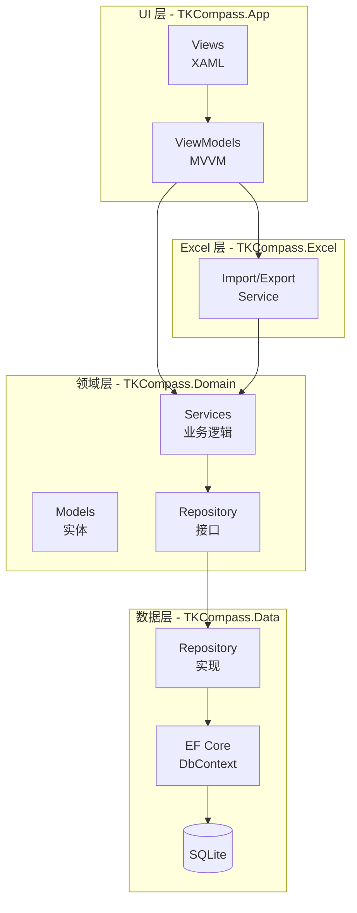
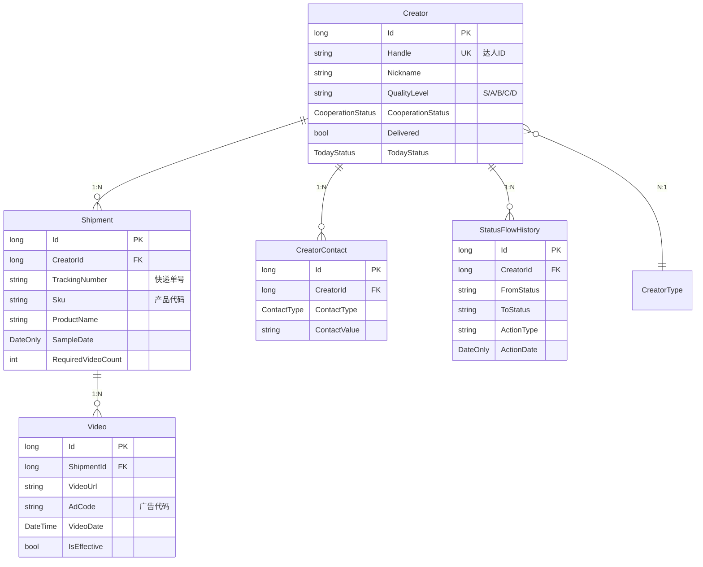

# TKCompass 项目分析报告

> 分析日期：2026-11-11  
> 项目路径：`/mnt/projects/Alon_All_In_One_CSharp`  
> 技术栈：.NET 10 + Avalonia 12.1.2 + SQLite + EF Core

---

## 一、项目概述

### 1.1 项目定位

**TKCompass** 是一款面向 TikTok 达人合作运营的 **单机桌面管理系统**，是原 Java 版本（Aolon Manager / TkerPivot）的 C# 重构版本。

**核心业务场景**：运营人员通过 TikTok 联系海外达人（KOL/KOC），完成「发送合作邀请 → 寄样 → 收视频 → 收广告代码 → 追踪出单」的全链路管理。

### 1.2 技术栈对比

| 维度 | Java 原版 | C# 重构版 |
|------|----------|----------|
| **UI 框架** | JavaFX 21 | Avalonia 12.1.2 |
| **语言** | Java 21 | C# / .NET 10 |
| **数据库** | SQLite + Flyway | SQLite + EF Core |
| **构建** | Gradle 8.x | dotnet CLI |
| **打包** | jpackage | Inno Setup |
| **架构** | 分层架构 | 分层架构（更清晰） |

### 1.3 当前开发状态

根据文档记录（2026-11-11）：
- **业务逻辑层**：100% 完成（10 个核心 ViewModel 全部实现）
- **UI 层**：待完善（XAML 视图绑定需要审查和完善）

**详细待办清单**：参见 [迭代文档](./docs/iterations/1.0/STATUS.md)

---

## 二、项目架构

### 2.1 解决方案结构

```
Alon_All_In_One_CSharp/
├── TKCompass.slnx                    # 解决方案文件
├── src/
│   ├── TKCompass.Domain/             # 领域层（核心业务）
│   │   ├── Models/                   # 实体模型
│   │   ├── Enums/                    # 枚举定义
│   │   ├── Repositories/             # Repository 接口
│   │   └── Services/                 # 业务服务
│   │
│   ├── TKCompass.Data/               # 数据层（持久化）
│   │   ├── Configuration/            # EF Core 配置
│   │   ├── Repositories/             # Repository 实现
│   │   └── TKCompassDbContext.cs     # EF Core 上下文
│   │
│   ├── TKCompass.App/                # 应用层（UI）
│   │   ├── ViewModels/               # MVVM ViewModel
│   │   ├── Views/                    # Avalonia XAML 视图
│   │   ├── Converters/               # 值转换器
│   │   └── DependencyInjection.cs    # DI 配置
│   │
│   └── TKCompass.Excel/              # Excel 导入导出
│       ├── ExcelExportService.cs
│       ├── ExcelImportService.cs
│       └── ImportPreview.cs
│
├── installer/
│   └── TKCompass.iss                 # Inno Setup 安装脚本
│
└── docs/                             # 文档目录
    ├── iterations/                   # 迭代记录
    ├── proposal/                     # 提案文档
    └── thoughts/                     # 设计思考
```

### 2.2 架构层次图



---

## 三、核心业务模型

### 3.1 实体关系图



### 3.2 状态机设计

系统有 **6 套独立的状态维度**，这是产品设计的核心：

#### 合作状态机（cooperation_status）
```
未触达 ──(新建)──▶ 已触达 ──(发送合作)──▶ 已发送合作 ──(同意+寄样)──▶ 已寄样
```

#### 今日任务状态（today_status）
| 状态 | 含义 | UI 表现 |
|------|------|---------|
| null/待处理 | 今日待跟进 | 出现在"今日提醒" Tab |
| 已提醒 | 今日已联系 | 从今日隐藏，明日继续 |
| 已解决 | 有进度推进 | 仍在今日列表 |

#### 已交付标记（delivered）
- **独立 boolean**，与合作状态正交
- 含义："暂时不合作"
- 支持"重新联系"恢复

#### 履约状态（视图计算）
| 状态 | 含义 | 颜色 |
|------|------|------|
| 催视频 | 寄样后无视频 | 🔴 红色 |
| 视频履约不足 | 视频数 < 要求数 | 🟡 黄色 |
| 优先催代码 | 视频够了缺代码 | 🟠 橙色 |
| 基础履约完成 | 视频+代码齐了 | 🟢 绿色 |

---

## 四、关键功能模块

### 4.1 达人工作台（6 个 Tab）

| Tab | 内容 |
|-----|------|
| **今日提醒** | 今日待跟进达人，按合作状态分组 |
| **正在交付** | 已同意合作或已寄样的达人 |
| **已提醒** | 今日已联系达人 |
| **已交付** | 暂时不合作的达人 |
| **总表** | 全部未删除达人 |
| **已删除** | 软删除的达人 |

### 4.2 统一筛选栏

所有 Tab 共用，支持 7 个字段组合筛选：
- Handle 搜索框（达人 ID）
- 状态下拉框
- 等级下拉框（S/A/B/C/D）
- 寄样时间范围
- 最后联系时间范围
- 产品代码多选
- 产品名搜索

### 4.3 撤销系统

- **Ctrl+Z** 撤销最近操作
- 操作历史持久化到 `operation_log` 表
- 支持跨重启撤销
- 批量操作分组回滚

### 4.4 Excel 导入

- 标准模板 V2（15 列）
- 三阶段自动导入：解析校验 → 字典自动创建 → 数据写入
- 视频-寄样自动关联（时间就近原则）

---

## 五、技术亮点

### 5.1 MVVM 架构

使用 **CommunityToolkit.Mvvm** 实现标准 MVVM：
- `ViewModelBase` 基类
- `[ObservableProperty]` 属性生成
- `[RelayCommand]` 命令绑定
- 数据绑定 + 命令绑定分离

### 5.2 依赖注入

```csharp
// DependencyInjection.cs
services.AddScoped<ICreatorService, CreatorService>();
services.AddScoped<ICreatorRepository, CreatorRepository>();
services.AddDbContext<TKCompassDbContext>(options => 
    options.UseSqlite(connectionString));
```

### 5.3 Repository 模式

- 接口定义在 Domain 层
- 实现在 Data 层
- 支持泛型基类 `BaseRepository<T>`

### 5.4 EF Core 配置

使用 Fluent API 配置实体映射：
```csharp
// CreatorConfiguration.cs
public void Configure(EntityTypeBuilder<Creator> builder)
{
    builder.ToTable("creators");
    builder.HasKey(e => e.Id);
    builder.Property(e => e.Handle).HasMaxLength(200);
    // ...
}
```

---

## 六、开发经验总结

根据 `DESIGN_LESSONS.md` 记录的关键教训：

### 6.1 Repository 模式设计

**教训**：Service 层方法签名必须与 Repository 接口匹配

```csharp
// ❌ 错误：直接传 Id
public async Task DeleteAsync(long id) => await _repository.DeleteAsync(id);

// ✅ 正确：先查询实体，再删除
public async Task DeleteAsync(long id)
{
    var entity = await _repository.GetByIdAsync(id);
    if (entity != null) await _repository.DeleteAsync(entity);
}
```

### 6.2 Avalonia XAML 绑定

**教训**：命名空间必须与 `x:Class` 完全匹配

```csharp
// XAML: x:Class="TKCompass.App"
// ✅ 正确
namespace TKCompass;  // 不是 TKCompass.AppBase
public partial class App : Application { }
```

### 6.3 连锁反应错误处理

**教训**：从底层项目开始修复编译错误

```
编译顺序：Domain → Data → App
底层项目失败会导致上层出现大量"找不到元数据文件"错误
```

---

## 七、项目统计

| 维度 | 数值 |
|------|------|
| **解决方案项目数** | 4 |
| **领域模型** | 15+ 实体 |
| **Repository 接口** | 14 个 |
| **Service 类** | 15+ 个 |
| **ViewModel** | 16 个 |
| **View** | 18 个 |
| **枚举** | 5 个 |

---

## 九、参考文档

| 文档 | 说明 |
|------|------|
| [TkerPivot.md](./TkerPivot.md) | 原 Java 版完整设计文档 |
| [TkerManageSys.md](./TkerManageSys.md) | 产品设计 & 功能清单 |
| [DESIGN_LESSONS.md](./DESIGN_LESSONS.md) | C# 重构经验教训 |
| [PACKAGING.md](./PACKAGING.md) | 打包发布文档 |

---

*分析完成时间：2026-11-11*
