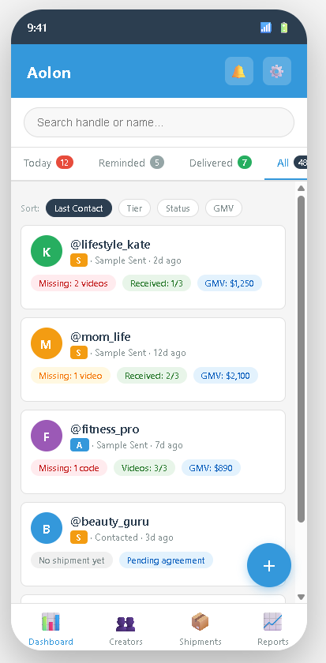
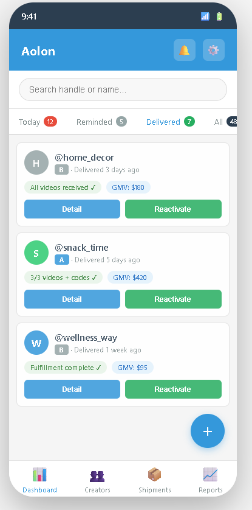
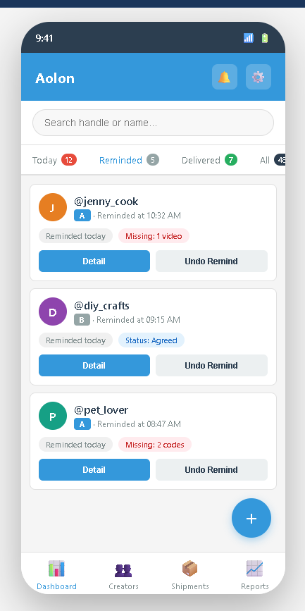
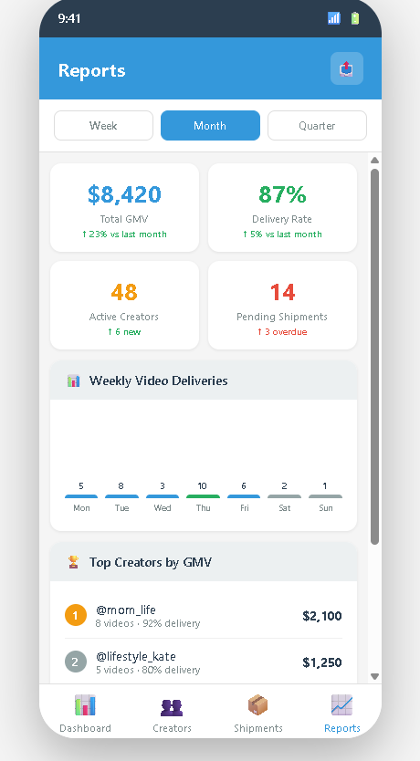
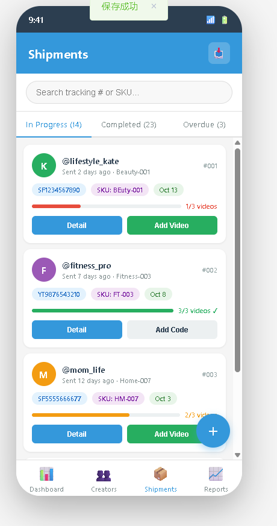
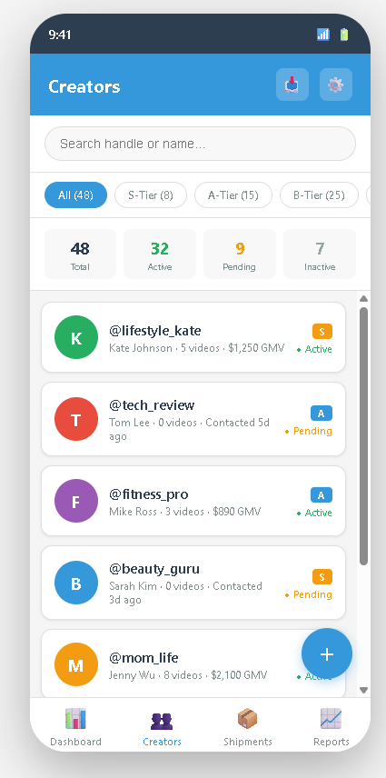
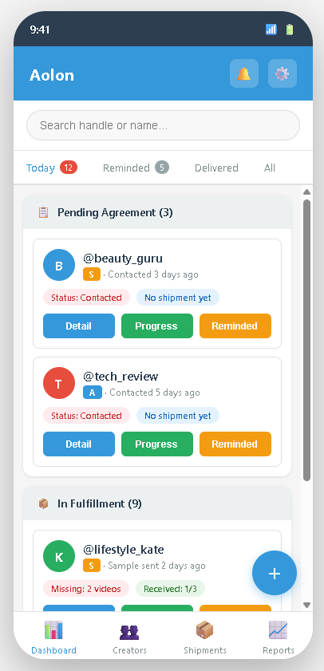

# TikTok Creator Management System - Project Proposal Report

**Student ID:** 60209978  
**Student Name:** Zhan Quan Zhuang  
**Project Name:** TikTokerManagementSys  
**Course:** EE5415 - Android Development  
**Date:** October 15, 2026

---

## App Name

**Aolon Creator Management** (达人管理)

An Android mobile app for TikTok Shop operators to manage creator collaborations, track sample shipments, monitor video deliverables, and maintain daily follow-up workflows — without requiring TikTok API access or developer accounts.

---

## Summary of the Project

### Vision

TikTok Shop's US market reached $4.9 billion in Q1 2026, doubling year-over-year. US store count has grown from 4,450 in mid-2023 to 475,000 in 2026. Behind this growth, many individual operators — often working alone or in small teams of 1–5 people inside cross-border e-commerce companies — manage 20 to 100+ TikTok creators for affiliate marketing campaigns every day.

These operators face a real problem: they quickly outgrow their tools. The typical workflow combines Excel spreadsheets (for creator lists), WeChat or WhatsApp (for communication), and mental notes (for tracking who owes what). When an operator manages more than 20 creators, this approach breaks down. Follow-ups are missed, tracking numbers get lost in chat history, it becomes impossible to tell which creators still owe videos, and monthly reviews require hours of manual data assembly.

The big SaaS platforms (达秘 Dami, Kalodata, FastMoss) solve a different problem — creator discovery and analytics — and they require TikTok API access, which means company-level approval and developer accounts that most small operators cannot get. The operator knows their workflow is broken, but the "proper" tools are not available to them.

Aolon is designed for this exact situation. It is a local, offline-first Android mobile app that helps the operator manage what happens *after* they have found creators and decided to work with them: tracking outreach status, shipment logistics, video deliverables, and daily follow-ups. No API. No cloud. No monthly fees. Just a structured, state-driven system that replaces the spreadsheet-and-chat workflow with something that does not fall apart at 30 creators.

### Scope

The system covers the full operational lifecycle of a creator collaboration:

1. **Creator Outreach Tracking** — who has been contacted, who has responded, who agreed
2. **Sample Shipment Management** — logistics codes, SKUs, shipment dates
3. **Video Deliverable Monitoring** — required vs. received videos, ad code tracking
4. **Daily Follow-up Workflow** — task-based reminders, status progression, priority sorting
5. **Performance Data** — GMV tracking, delivery completion rates

The application runs on Android as a native mobile app built with Kotlin and Jetpack Compose. All data is stored locally in Room database, with automatic backups to local storage. No internet connection is required for core operations.

---

## Preliminary List of Functional Requirements

### Core Features

1. **Creator Management**
   - Add, edit, and soft-delete creator profiles
   - Store TikTok handle, nickname, quality tier (S/A/B), contact history
   - Search and filter creators by status, tier, or last contact date
   - Import creators from Excel files (batch upload via file picker)

2. **Collaboration State Machine**
   - Enforce sequential status progression: Unreached → Contacted → Collaboration Sent → Agreed → Sample Sent → Delivered
   - Prevent skipping stages (for example, cannot mark "Sample Sent" without recording a tracking number)
   - Track status change history with timestamps

3. **Sample Shipment Tracking**
   - Record shipment details: tracking number, SKU, product code, shipment date
   - Link multiple shipments to a single creator (repeat collaborations)
   - Set required video count per shipment (default: 3 videos)
   - Track shipment status

4. **Video Deliverable Monitoring**
   - Record video URLs and corresponding ad codes
   - Calculate missing videos and missing ad codes per shipment
   - Color-coded status indicators (red = missing, green = complete, blue = exceeded)
   - Mark videos as "effective" for fulfillment calculation

5. **Daily Follow-up Workflow**
   - Generate daily task list: "Today's Follow-up" screen
   - Sort creators by last contact date (oldest first)
   - Limit follow-up to once per creator per day
   - Three action buttons per creator: "Progress" (advance status), "Reminded" (hide until tomorrow), "Delivered" (mark as temporarily inactive)
   - Separate tabs for "Reminded Today" and "Delivered/Inactive"

6. **Creator Detail View**
   - Expandable cards for each shipment
   - Inline editing of ad codes in video list
   - Quick-add buttons for new videos and ad codes
   - Aggregated metrics: total missing videos, missing codes, GMV

7. **Data Import/Export**
   - Import creators, shipments, and videos from Excel files
   - Handle mixed-format spreadsheets (auto-detect columns)
   - Export complete dataset for backup or analysis

8. **Local Data Storage**
   - Room database stored in app's internal storage
   - Automatic backup on startup and first daily use
   - Single-instance enforcement (prevent duplicate launches)

9. **User Interface**
   - Android native UI with Material Design 3 components
   - Bottom navigation bar (Dashboard, Creators, Shipments, Reports)
   - Card-based layouts optimized for touch interaction
   - Floating Action Button (FAB) for quick-add operations
   - Swipe gestures for common actions (swipe to remind, swipe to progress)

---

## Major Functions and Related Theory

### 1. State Machine for Collaboration Workflow

**Function:** The system enforces a strict, unidirectional state machine for creator collaborations. Each creator progresses through five stages: Unreached → Contacted → Collaboration Sent → Agreed → Sample Sent. Status transitions require specific actions (for example, entering a tracking number to move from "Agreed" to "Sample Sent").

**User Story:**
> As an operator, I want the system to prevent me from marking a creator as "Sample Sent" unless I have entered the tracking number, so that I never lose track of which samples are in transit and can always give creators accurate delivery updates.

**Why it matters:** In the spreadsheet-and-chat workflow, there is no enforcement. An operator might mark a creator as "agreed" but forget to record the shipment, then weeks later neither the operator nor the creator remembers what was sent. The state machine makes these gaps impossible: you physically cannot advance to the next stage without filling in the required data. This is not about making the operator's life harder — it is about preventing the exact forgetting errors that cause collaboration failures.

### 2. Daily Task List with Priority Sorting

**Function:** The system generates a daily task list ("Today's Follow-up") that shows operators exactly which creators need attention. Creators are sorted by last contact date (oldest first), so the operator always starts with the person they have not spoken to in the longest time. Each creator can be followed up once per day. The operator chooses from three actions:

- **Progress** — advance the creator to the next collaboration stage
- **Reminded** — mark as contacted today, hide until tomorrow
- **Delivered** — mark as temporarily inactive (not cooperating for now)

**User Story:**
> As an operator managing 50 creators, I want to open the app each morning and see a prioritized list of who to contact today — sorted by who I have not contacted in the longest time — so that I do not accidentally neglect high-potential creators and can maintain consistent communication across all of them.

**The prioritization logic:** When an operator manages 50 creators, the hardest question is not "how do I contact them" but "who do I start with?" The spreadsheet approach has no answer — the operator just picks names randomly or works from the top of the list, which means the same 10 creators at the top get contacted every day while the bottom 20 are forgotten for weeks.

Sorting by "oldest last contact date" solves this with a simple rule: the person you have not spoken to in the longest time gets your attention first. This ensures even coverage across the entire creator pool. The once-per-day limit prevents the operator from over-contacting a few creators while ignoring others — a common failure mode when operators feel anxious about deadlines.

This follows the same logic as **round-robin scheduling** in computer science: each "process" (creator) gets a turn in order, and no single process monopolizes the resource (the operator's attention). The result is that every creator gets contacted at a roughly consistent frequency, which is exactly what relationship management requires.

### 3. Shipment and Video Deliverable Tracking

**Function:** For each collaboration, operators record sample shipments (tracking number, SKU, shipment date) and track video deliverables. The system calculates missing videos and missing ad codes automatically, using color-coded indicators (red = missing, green = complete, blue = exceeded requirements).

**User Story:**
> As an operator, I want to see at a glance how many videos each creator still owes me, with red indicators for missing items, so that I can prioritize follow-up conversations with creators who are behind on their deliverables and make sure I get the agreed-upon content.

**Why it matters:** In the current workflow, an operator might have sent samples to 30 creators and is waiting for each of them to produce 3 videos. Tracking who has delivered 0, 1, 2, or 3 videos requires opening multiple Excel rows, counting manually, and cross-referencing with chat messages. The system replaces this with a single dashboard view where red/green indicators make the status immediately obvious — no counting required.

### 4. Local-First, No-API Architecture

**Function:** All data is stored in a local Room database, with automatic backups and no cloud dependency. The application runs as a standalone Android mobile app, requiring no internet connection for core operations.

**User Story:**
> As an operator in a small cross-border e-commerce company, I know that tools like 达秘 or Kalodata exist, but my company will not apply for TikTok API access — that requires company-level communication with TikTok, and we are too small. I need something that works with what I already have: my Excel file and my own phone.

**Why it matters:** The target user is not choosing between Aolon and 达秘. They are choosing between Aolon and their current broken spreadsheet workflow. The big SaaS platforms are not an option because they require API access that the operator's company will not provide. Aolon exists specifically for this gap: the operator knows their workflow is inefficient, but the "proper" enterprise tools are not available to them. A local mobile app that works without any API, without any cloud, and without any subscription is the only realistic tool for this situation.

### 5. Mobile-First Design for On-the-Go Operations

**Function:** The Android app is designed for mobile use, with touch-optimized interfaces, one-hand operation support, and quick access to critical information. Unlike desktop applications that require sitting at a computer, the mobile app allows operators to check status, update records, and manage follow-ups while commuting, in meetings, or during brief breaks.

**User Story:**
> As an operator who is often away from my desk, I want to check which creators need follow-up today, update shipment status, and mark videos as received — all from my phone — so that I can stay on top of my work even when I'm not at my computer.

**Why it matters:** Desktop applications lock operators to their workstations. In reality, TikTok Shop operators are often multitasking: managing creators while commuting, checking shipment status during lunch, or updating records between meetings. A mobile app removes this constraint. The operator can open the app, see what needs attention, take action in 30 seconds, and close it. This matches the real workflow of someone managing 50+ creators across different time zones.

---

## User Interface Design

The UI wireframes are provided as interactive HTML files in the `proposal/UI-Design/` folder. Open them in a browser to view the mobile-optimized layouts:

| Screen | File | Description |
|--------|------|-------------|
| Mobile Dashboard | `mobile-dashboard.html` | Main screen with card-based creator list, tab navigation, and bottom nav bar |
| Mobile Creator Detail | `mobile-creator-detail.html` | Detail view with expandable shipment cards, video list, and action bar |
| Mobile New Shipment | `mobile-shipment-form.html` | Form screen with creator selector, date picker, and video count selector |

**Design notes:**

- **Mobile-first layout:** All screens are designed for narrow (375px) mobile displays, not wide desktop monitors
- **Card-based interface:** Creator information is displayed in cards instead of table rows, making it easier to read on small screens
- **Bottom navigation:** Four main sections (Dashboard, Creators, Shipments, Reports) accessible via bottom nav bar — a standard Android pattern
- **Floating Action Button (FAB):** Quick-add button for creating new creators or shipments, positioned for thumb access
- **Expandable sections:** Shipment details collapse/expand to save screen space, instead of using modal dialogs
- **Touch-optimized buttons:** All action buttons are at least 48dp (Android's minimum touch target size)
- **Swipe gestures:** Common actions (remind, progress) can be triggered by swiping cards left/right
- **Single-column flow:** Information is presented in a vertical scroll, not side-by-side panels
- **Color-coded status:** Red/green/blue indicators for missing/complete/exceeded items, visible at a glance

**Key differences from desktop design:**

| Desktop (JavaFX) | Mobile (Android) |
|------------------|------------------|
| Wide tables with many columns | Cards with key information only |
| Modal dialogs for data entry | Full-screen forms or bottom sheets |
| Tab bar at top | Bottom navigation bar |
| Multiple panels visible at once | Single focus, drill-down navigation |
| Mouse hover for details | Tap to expand or view detail |
| Keyboard shortcuts | Swipe gestures and FAB |

  
  
  
  

  
  
  

---

## Market Research with Competitive Analysis

### Market Context

TikTok Shop's US market reached $4.9 billion in Q1 2026, doubling year-over-year. The platform's 2026 global GMV target is $112.2 billion. US store count has grown from 4,450 (mid-2023) to 475,000 (2026). 45% of US consumers now make purchases after seeing products on TikTok.

This growth has created a large population of individual operators — typically working inside small cross-border e-commerce companies — who manage TikTok creator partnerships as their daily job. These operators are not the decision-makers who can apply for TikTok API access or purchase enterprise SaaS tools. They are the people who feel the pain of a broken workflow every day but have no authority to change the tool stack.

### Target User

**Who they are:**
- Individual TikTok Shop operators, or teams of 1–5 people
- Typically based in China, managing US/UK/SEA TikTok creators
- Managing 20–100 creators for affiliate marketing campaigns
- Do not have TikTok developer permissions or API access
- Currently use Excel + WeChat/WhatsApp for tracking
- Know their workflow is inefficient but lack the tools to fix it

**What they cannot do:**
- They cannot apply for TikTok API access (requires company-level approval)
- They cannot purchase enterprise SaaS tools (requires budget approval)
- They cannot switch to a completely different workflow (the current process is all they know)

**What they need:**
- A tool that works with what they already have (Excel files, manual data)
- Something that does not require API access or cloud accounts
- A solution that fits into their existing workflow rather than replacing it entirely
- A mobile app they can use on the go, not just at their desk

### Competitive Landscape

The existing tools in this space fall into three categories. None of them serve the target user.

#### Category 1: Creator Discovery & Analytics Platforms (达秘 Dami, Kalodata, FastMoss, EchoTik)

These are SaaS platforms built by companies that have TikTok API access. They focus on:
- Searching and filtering creators from large databases
- Performance analytics (GMV, engagement rates, trend tracking)
- Batch outreach tools and campaign management

**Why they do not serve our user:**
- Require TikTok API access, which the target user's company will not provide
- Focus on "finding creators" rather than "managing the daily workflow after you've found them"
- Priced for companies, not individual operators ($50–500/month)
- Cloud-based, which raises data privacy concerns
- Desktop-focused web interfaces, not optimized for mobile use

These tools solve the "discovery" problem. Our user's problem is the "execution" problem — they already know who they want to work with, but managing the day-to-day collaboration is where things fall apart.

#### Category 2: General Project Management Tools (Notion, Trello, Asana, Airtable)

These are flexible, customizable tools that can be adapted to any workflow.

**Why they do not serve our user:**
- Not designed for creator management — no built-in support for shipment tracking, video deliverables, or collaboration state machines
- Require manual setup for each workflow, which is fragile and breaks at scale
- SaaS pricing and cloud-based
- The operator ends up building a complex, brittle system in Notion that works for 15 creators but falls apart at 30
- Mobile apps exist but are not optimized for the specific workflow of TikTok creator management

#### Category 3: Spreadsheet + Messaging App (Current Status Quo)

This is what the target user is doing today:
- Excel for creator lists
- WeChat/WhatsApp for communication
- Mental notes for tracking what is owed

**Why it breaks:**
- Does not scale beyond ~20 creators
- Error-prone: manual data entry, lost messages, forgotten follow-ups
- No automation or reminders
- No audit trail
- Monthly reviews require hours of manual data assembly
- Not mobile-friendly: Excel on a phone is painful to use

### Aolon's Position

Aolon does not compete with 达秘 or Kalodata. They operate at a different layer:

| | 达秘 / Kalodata | Aolon |
|---|---|---|
| **Layer** | Creator discovery & analytics | Operational workflow execution |
| **Question it answers** | "Which creators should I work with?" | "How do I manage the creators I'm already working with?" |
| **API required** | Yes (TikTok developer account) | No |
| **User** | Companies with API access | Individual operators without API access |
| **Pricing** | $50–500/month SaaS | Local mobile app, no subscription |
| **Data** | Cloud | Local Room database |
| **Platform** | Desktop web | Android mobile |
| **When to use** | Before you start working with creators | After you've decided to work with them |

Aolon solves the "last mile" problem. The operator has already found their creators (manually, or through whatever means). The question now is: how do I manage 50 ongoing collaborations without losing my mind? That is the problem Aolon addresses.

### How Aolon Solves the Problem for Operators Without TikTok API Access

The core insight is that most of the operational workflow does not require API access at all. Tracking which creators you have contacted, what samples you have sent, which videos you are waiting for — none of this needs TikTok's permission. It is the operator's own business data.

Aolon takes advantage of this by:

1. **Working entirely with manual data entry and Excel import** — no API calls needed
2. **Focusing on the operational workflow** — the part of the job that happens *around* TikTok, not *inside* TikTok
3. **Storing everything locally** — no cloud accounts, no API keys, no company approvals
4. **Enforcing structure through the state machine** — replacing the operator's mental notes with a system that physically prevents forgetting
5. **Providing a mobile-first experience** — the operator can manage their workflow from anywhere, not just at a desk

The operator does not need TikTok's permission to manage their own workflow. They just need a tool that is designed for this specific job. Aolon is that tool.

---

## Implementation Plan

The system will be built as a native Android application using modern Android development practices:

**Technology Stack:**
- **Language:** Kotlin (primary), with Java interoperability where needed
- **UI Framework:** Jetpack Compose with Material Design 3
- **Database:** Room (SQLite abstraction) with Flow for reactive data
- **Architecture:** MVVM (Model-View-ViewModel) with clean architecture principles
- **Dependency Injection:** Hilt (Dagger-based)
- **Navigation:** Jetpack Navigation Compose
- **File I/O:** Apache POI for Excel import/export
- **Minimum SDK:** API 24 (Android 7.0)
- **Target SDK:** API 34 (Android 14)

**Project Structure:**
- `data` — Room entities, DAOs, database, repositories
- `domain` — Use cases, business logic, state machine
- `ui` — Compose screens, ViewModels, navigation
- `util` — Excel import/export, date formatting, backup utilities

**Development Milestones:**
1. Database schema and Room entities (Creator, Shipment, Video, StatusFlowHistory)
2. State machine logic and use cases
3. Dashboard screen with tab navigation and card list
4. Creator detail screen with expandable shipment sections
5. Shipment and video management forms
6. Daily follow-up workflow with priority sorting
7. Excel import/export functionality
8. Backup and data migration utilities
9. Testing and polish

---

## References

1. **Q1销售额49亿美元同比翻倍！TikTok Shop美国站增长仍在加速** — 跨境圈 (2026-05-26)  
   https://wp.tikclubs.com/2330.html

2. **MCN都在踩的达人管理工具选型坑：不是功能不够用，是没搞清自己卡在哪** — 达秘工具 (2026-08-05)  
   https://www.menglar123.com/dr/98207.html

3. **合作超过30个达人后，Excel+微信群一定会崩：达人管理的四个失控点和重建顺序** — 达秘工具  
   https://www.menglar123.com/dami/105928.html

4. **美国TikTok达人联盟怎么选怎么进？我花了一周整理出这份避坑指南** — 达秘工具 (2026-08-04)  
   https://www.menglar123.com/dr/97878.html

5. **达秘达人管理系统操作指南** — 达秘工具  
   https://www.menglar123.com/dami/89999.html

---

**End of Proposal Report**
